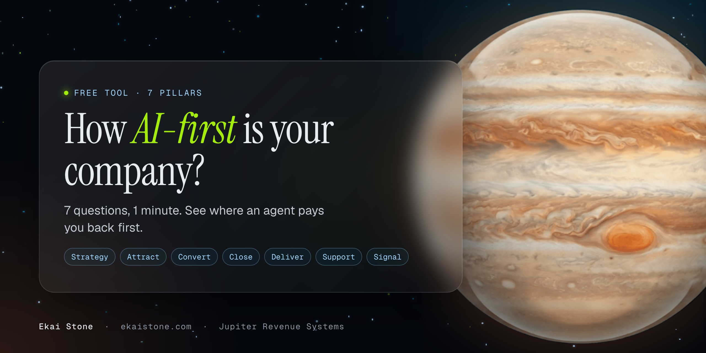

<h1 align="center">The AI-First Company Scorecard</h1>

<b>7 questions. 7 pillars. About a minute.</b> See how AI-first your business really is, and where an agent pays you back first.

<a href="https://jupiter-revenue-systems.github.io/ai-first-company-scorecard/"><b>Take the scorecard →</b></a> &nbsp;·&nbsp; <a href="SCORECARD.md">Print version</a>

---

## Why this exists

Most businesses don't need more AI tools. They need the work to run without them in the middle of it. An AI-first company is one where agents do the work and people check it: content, ads, replies, booking, delivery, support and tracking.

This scorecard shows you where you are today, pillar by pillar, so you fix the gap that costs you most first.

## The 7 questions

One per pillar.

| # | Pillar | Question |
|---|---|---|
| 1 | **Strategy** | Your processes are written down clearly enough that an AI agent could run them. |
| 2 | **Attract** | Your content gets drafted in your voice by an agent, and you approve it instead of writing it. |
| 3 | **Convert** | Every lead from your site, forms and free tools lands in your CRM and gets followed up on its own. |
| 4 | **Close** | Every DM and form lead gets a reply within minutes, day or night, and calls get booked without you. |
| 5 | **Deliver** | Buyers get what they paid for within minutes, without you touching it. |
| 6 | **Support** | Common questions get answered by an agent trained on your own docs, around the clock. |
| 7 | **Signal** | You can tell which ad brought in each sale, and your ad platform counts the same sales your CRM does. |

## How scoring works

Each question gets a score from 0 to 3:

| Score | Means |
|---|---|
| 0 | Not in place |
| 1 | Manual: a person does it |
| 2 | Partly automated |
| 3 | AI-run, a person checks |

The total is out of 21. Your score is the total as a percentage:

| Score | Band |
|---|---|
| 0% to 34% | **Manual company.** You are the system. |
| 35% to 59% | **Tool-stacked.** Lots of apps, few agents. |
| 60% to 84% | **AI-assisted.** Agents do real work in parts of the business. |
| 85% to 100% | **AI-first company.** Agents run the work and people check it. |

## Use it your way

- **Online:** [take it here](https://jupiter-revenue-systems.github.io/ai-first-company-scorecard/). Your answers stay in your browser.
- **On paper or in a team meeting:** [SCORECARD.md](SCORECARD.md).
- **On your own site:** `index.html` is one file with no dependencies. Fork it, change the questions in the `D` object, and host it anywhere.
- **In your own tools:** the questions, scale and bands are in [`scorecard.json`](scorecard.json).

## Want the gaps closed for you?

- **Strategy Session ($750):** an hour on your score and the order to fix it. [ekaistone.com/strategy-session](https://ekaistone.com/strategy-session?utm_source=github&utm_medium=readme)
- **Seven Star Build:** we turn your business into an AI-first company, on accounts you own, live in 7 days. [ekaistone.com/seven-star/build](https://ekaistone.com/seven-star/build?utm_source=github&utm_medium=readme)

## License

MIT. Use it with your own clients.

---

Built by [Jupiter Revenue Systems](https://ekaistone.com). Star the repo if it helps.
